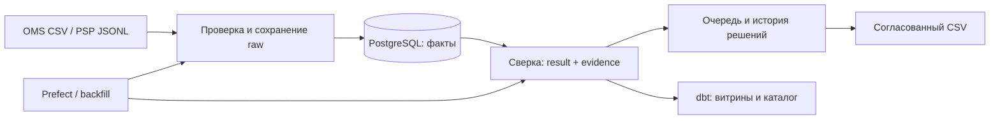

# CommerceGuard

**Я сверяю заказы, платежи и возвраты — и довожу расхождение до объяснимого решения.**

Я разработал информационную систему для финансового специалиста: принимаю файлы
OMS/PSP, сохраняю исходные данные, рассчитываю расхождения и показываю их в рабочей
очереди с ролями и историей действий. Это мой портфельный проект на синтетических
данных с проверенной локальной поставкой.

**Python · PostgreSQL · SQL · dbt · Prefect · Docker Compose**

**[Открыть полный код v1.0.0](https://github.com/Decl1s/commerceguard/tree/v1.0.0)** ·
[Демонстрация за 10 минут](https://github.com/Decl1s/commerceguard/blob/v1.0.0/docs/DEMO.md) ·
[Релиз и архив](https://github.com/Decl1s/commerceguard/releases/tag/v1.0.0) ·
[Успешный CI](https://github.com/Decl1s/commerceguard/actions/runs/40409886361)

В `main` я оставляю эту обзорную страницу. Полный исходник, инструкции и проверки
стабильной версии я закрепил в **теге `v1.0.0`**; для запуска клонирую именно его.

## Какую задачу я решаю

Заказ в OMS и платёж в PSP могут появиться в разное время. У заказа бывают частичные
оплаты, возвраты, отдельные сроки и поздние корректировки. Одного сравнения двух
итоговых сумм недостаточно: мне нужно объяснить источник каждой суммы, сохранить
предыдущий результат и отделить расчёт от решения специалиста.

Я провожу данные через весь путь: **файл → проверка → факты → сверка → разбор → аудит**.
Исчезнувшее расхождение не закрывает человеческий разбор автоматически, а новый
пересчёт не подменяет сохранённые исторические результаты.

## Что я реализовал

| Область | Мой результат |
| --- | --- |
| Приём данных | OMS CSV v1/v2, PSP JSONL, manifest/EOF/SHA, immutable raw, COPY и атомарная публикация партии; повтор без двойных фактов |
| Денежная сверка | Capture/refund отдельно, RUB/USD/EUR без смешения, deadlines, два времени, immutable run/result/evidence |
| Поздние события | Корректировки и backfill на 1–31 день по сохранённым identities; прежний результат остаётся доступным |
| Settlement | Версии выписки, membership и независимый тариф; объяснение gross/refund/fee/net и неизвестного результата |
| Аналитика | 9 dbt-витрин, предварительная агрегация, 19 тестов данных, каталог grain/key/time/currency/lineage |
| Оркестрация | Prefect run/resume, preflight и ограниченные повторы временных отказов |
| Рабочее место | Русская очередь, фильтры, карточка с источниками, назначение, комментарий, закрытие и повторное открытие с причиной |
| Доступ и аудит | Viewer/analyst/manager, merchant scopes, server sessions, CSRF/Origin/Host, optimistic concurrency и история действий |
| Экспорт | Согласованный CSV одной валюты, защита формул и ограничение 10 000 строк |
| Эксплуатация | 15 миграций PostgreSQL, 31 таблица, backup БД + raw, восстановление с квитанцией, health/metrics и JSON logs |
| Поставка | Docker Compose, Waitress, Caddy, отдельная runtime SQL role, секреты вне Git и закреплённые зависимости |



## Как я запускаю и показываю проект

Мой подтверждённый профиль: **Linux x86_64, Docker Engine/Compose, одна организация,
localhost**. Для первого запуска я выделяю минимум 4 GiB свободной памяти и место
для образов, БД, raw и резервных копий. Это ориентир установки; ёмкость рабочего
бизнеса я отдельно не измерял.

```bash
git clone --branch v1.0.0 --single-branch https://github.com/Decl1s/commerceguard.git
cd commerceguard
python3 deploy/configure.py
docker compose --env-file workspace/deployment/.env -f deploy/compose.yml up -d --build --wait
```

Я открываю `http://127.0.0.1:8765/login` под `manager`. Случайный пароль читаю
**локально** из `workspace/deployment/operator_password`. Configure создаёт секреты
в закрытом каталоге и сохраняет уже существующую настройку. В новую установку
я могу явно загрузить синтетический пример:

```bash
docker compose --env-file workspace/deployment/.env -f deploy/compose.yml run --rm --build tools demo
```

Для показа я прохожу импорт, очередь расхождений, объяснение суммы, решение с
аудитом и выгрузку CSV. По [DEMO](https://github.com/Decl1s/commerceguard/blob/v1.0.0/docs/DEMO.md)
я повторяю этот маршрут за 10 минут. Свои входные файлы и аккаунты подключаю по
[HANDBOOK](https://github.com/Decl1s/commerceguard/blob/v1.0.0/docs/HANDBOOK.md).
Полный порядок установки, остановки с сохранением volumes и резервирования я
описал в [DEPLOYMENT](https://github.com/Decl1s/commerceguard/blob/v1.0.0/docs/DEPLOYMENT.md).

## Чем я подтверждаю результат

Я прошёл **99 уникальных unit-тестов в трёх runtime-профилях**, проверки реального
PostgreSQL, миграций, транзакций и конкурентного доступа, 9 dbt-витрин / 19 тестов
данных, Prefect retry/resume, HTTP, Chrome и Docker Compose. Я восстановил резервную
копию в другой кластер, проверил импорт из хоста, повтор, экспорт и сохранность
сессий и volumes при перезапуске.

Я связываю эти результаты с конкретной поставкой:
[финальный CI](https://github.com/Decl1s/commerceguard/actions/runs/40409886361),
[VALIDATION](https://github.com/Decl1s/commerceguard/blob/v1.0.0/VALIDATION.md) и
[RELEASE_CHECKLIST](https://github.com/Decl1s/commerceguard/blob/v1.0.0/docs/RELEASE_CHECKLIST.md).
В workflow я также проверяю известные уязвимости трёх закреплённых наборов зависимостей.

## Где я объясняю решения

| Мне нужно | Где я это описал |
| --- | --- |
| Быстро понять проект и открыть его в IDE | [START_HERE](https://github.com/Decl1s/commerceguard/blob/v1.0.0/START_HERE.md), [PROJECT_MAP](https://github.com/Decl1s/commerceguard/blob/v1.0.0/docs/PROJECT_MAP.md) |
| Разобрать контракты и причины решений | [DATA_CONTRACTS](https://github.com/Decl1s/commerceguard/blob/v1.0.0/docs/DATA_CONTRACTS.md), [DECISIONS](https://github.com/Decl1s/commerceguard/blob/v1.0.0/DECISIONS.md), [TECHNOLOGIES](https://github.com/Decl1s/commerceguard/blob/v1.0.0/TECHNOLOGIES.md) |
| Изучить код и попробовать изменения | [NOTES](https://github.com/Decl1s/commerceguard/blob/v1.0.0/NOTES.md), [EXERCISES](https://github.com/Decl1s/commerceguard/blob/v1.0.0/EXERCISES.md), [HANDBOOK](https://github.com/Decl1s/commerceguard/blob/v1.0.0/docs/HANDBOOK.md) |
| Сопровождать экземпляр | [BACKUP](https://github.com/Decl1s/commerceguard/blob/v1.0.0/docs/BACKUP.md), [OPERATIONS](https://github.com/Decl1s/commerceguard/blob/v1.0.0/docs/OPERATIONS.md), [PERFORMANCE](https://github.com/Decl1s/commerceguard/blob/v1.0.0/docs/PERFORMANCE.md) |
| Посмотреть этапы и фактическую историю | [PROGRESS](https://github.com/Decl1s/commerceguard/blob/v1.0.0/docs/PROGRESS.md), [KANBAN](https://github.com/Decl1s/commerceguard/blob/v1.0.0/docs/KANBAN.md), [WORKLOG](https://github.com/Decl1s/commerceguard/blob/v1.0.0/docs/WORKLOG.md) |

## Какие границы я сохраняю

В 1.0 я работаю с файловыми входами. Я не выполняю платежи, проводки и конвертацию
валют; PSP API, расписание, SSO, HA и SaaS оставил вне этой версии. Для raw и audit
я планирую диск вручную: автоматической retention пока нет. Поддержку Windows/macOS,
произвольный SLA, коммерческую нагрузку или внешнюю приёмку я не заявляю.

## Как я готовлю будущий деплой

Я отдельно подготовил **1.1.0.dev1** для будущего домена и HTTPS, сохранив локальный
профиль. В этой ветке я добавил persistent certificates, управление экземпляром и
инструкцию переноса. Я подтвердил 104 unit-теста в трёх профилях, прежние интеграционные
проверки и отдельный HTTPS smoke в [CI](https://github.com/Decl1s/commerceguard/actions/runs/40464921599).
Внешний сервер и домен я пока не разворачивал, публичный сертификат не выпускал.

[Код подготовки HTTPS](https://github.com/Decl1s/commerceguard/tree/codex/https-deployment) ·
[PR #53, draft](https://github.com/Decl1s/commerceguard/pull/53) ·
[Инструкция localhost / будущий сервер](https://github.com/Decl1s/commerceguard/blob/codex/https-deployment/docs/INTERNET_DEPLOYMENT.md)

<details>
<summary>Моя квитанция стабильного выпуска 1.0.0 от 27.10.2026</summary>

Я закрепил 184 разрешённых исходных файла в commit
`b699899529449ec53f45ee6e2dc3106e09076bc5`. Скачанный публичный архив совпал с
проверенным локальным; отдельно я выполнил Compose/Chrome-прогон из этого архива.

- [Исходный архив](https://github.com/Decl1s/commerceguard/releases/download/v1.0.0/commerceguard-1.0.0-sources.tar.gz)
- [Файл SHA256](https://github.com/Decl1s/commerceguard/releases/download/v1.0.0/commerceguard-1.0.0-sources.tar.gz.sha256)
- SHA256: `913320b00ebc150d6d5daf6e3a975957e24f6de20290f075ed1dacd5148ce321`
- [Финальный CI](https://github.com/Decl1s/commerceguard/actions/runs/40409886361)

Я сохраняю стабильный тег неизменяемым. Исторические PR и ранние документы остаются
историей разработки; актуальные результаты я читаю по версии выпуска.

</details>
