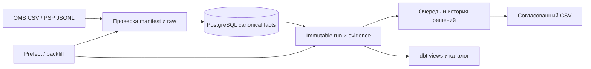

# CommerceGuard

Я разработал информационную систему сверки заказов, оплат и возвратов: от файла OMS/PSP до объяснения суммы, решения финансового специалиста и истории изменений. Это мой самостоятельный портфельный проект с синтетическими примерами и рабочей поставкой. Реального клиента и коммерческий опыт проекту не приписываю.

**Первая версия1.0.0 · 27.10.2026.** Я завершил30 историй и подтвердил полный [CI кандидата](https://github.com/Decl1s/commerceguard/actions/runs/40408987370). Для окончательного commit CI повторяет все обязательные gates; tag и архив публикуются только после их успеха. [Релиз и архив](https://github.com/Decl1s/commerceguard/releases/tag/v1.0.0), [история CI](https://github.com/Decl1s/commerceguard/actions), [матрица](docs/RELEASE_CHECKLIST.md), [этапы](docs/PROGRESS.md).

## Что я реализовал

| Контур | Результат |
| --- | --- |
| Приём | OMS CSV v1/v2, PSP JSONL, manifest/EOF/SHA, immutable raw, атомарный COPY/publish, журнал и восстановление; повтор без двойных фактов |
| Сверка | Capture/refund отдельно, RUB/USD/EUR без смешения, deadlines, два времени, immutable run/result/evidence, поздние корректировки |
| Settlement | Версии выписки, membership, независимый тариф, gross/refund/fee/net, объяснимое unknown |
| Аналитика | 9dbt views, предварительная агрегация,19data tests, каталог grain/key/time/currency/lineage |
| Оркестрация | Prefect run/resume, preflight, ограниченный retry; backfill1…31 день по сохранённым identities |
| Рабочее место | Русская очередь, фильтры, страницы, карточка с источниками, назначение/комментарий, закрытие/повторное открытие с причиной |
| Доступ | Viewer/analyst/manager, merchant scopes, server sessions, CSRF/Origin/Host, optimistic concurrency, immutable human audit |
| Экспорт | Согласованный CSV одной валюты, canonical context, защита формул, лимит10000 строк |
| Эксплуатация | PostgreSQL15 миграций/31 таблица, DB+raw backup/проверка/restore receipt, health/metrics, ограниченные JSON logs |
| Поставка | Docker Compose, Waitress, Caddy, отдельный runtime SQL role, секреты вне Git, pinned dependencies/base digests |



Я отделил финансовое наблюдение от человеческого решения: исчезнувшее расхождение не закрывает разбор автоматически. Историческая корректировка остаётся отдельным report и не подменяет текущий canonical baseline. Прежние результаты сохраняю.

## Как я запускаю рабочий экземпляр

Мой проверенный профиль: **Linux x86_64, Docker Engine/Compose, одна организация, локальный доступ**. Я выделяю минимум4GiB свободной памяти и место для image/БД/raw/backup; это ориентир запуска, не доказанная ёмкость бизнеса. Первый build скачивает закреплённые образы и Python пакеты. Для внешнего домена отдельно настраиваю TLS.

```bash
git clone --branch v1.0.0 --single-branch https://github.com/Decl1s/commerceguard.git
cd commerceguard
python3 deploy/configure.py
docker compose --env-file workspace/deployment/.env -f deploy/compose.yml up -d --build --wait
```

Я открываю http://127.0.0.1:8765/login под `manager`. Случайный пароль читаю локально из `workspace/deployment/operator_password`. Configure создаёт три независимых секрета в закрытом каталоге, существующие настройки не перезаписывает. Реальных бизнес-данных в новой установке нет. Я могу явно загрузить пример:

```bash
docker compose --env-file workspace/deployment/.env -f deploy/compose.yml run --rm --build tools demo
```

Для своих файлов использую `deploy/import_input.py` и отдельные prepare/execute/case apply. Команды и порядок — [HANDBOOK](docs/HANDBOOK.md). Аккаунты создаю owner tools; пароли ввожу getpass. Обычная остановка `docker compose ... down` сохраняет volumes. `down --volumes` удаляет данные, для рабочей остановки его не использую. Полный порядок установки, резервирования и внешнего доступа — [DEPLOYMENT](docs/DEPLOYMENT.md).

## Как я проверяю исходники

```bash
python3.12 -m venv .venv
.venv/bin/pip install --require-hashes -r requirements-analytics.lock
.venv/bin/python -m unittest discover -s tests -v
.venv/bin/python scripts/check_postgres.py --pg-bin /usr/lib/postgresql/16/bin
python3.12 -m venv .venv-orchestration
.venv-orchestration/bin/pip install --require-hashes -r requirements-orchestration.lock
.venv-orchestration/bin/python scripts/check_pipeline.py --pg-bin /usr/lib/postgresql/16/bin
python3.12 -m venv .venv-validation
.venv-validation/bin/pip install --require-hashes -r requirements-validation.lock
.venv-validation/bin/python scripts/check_browser.py
```

Integration runners требуют обычную учётную запись с доступными PostgreSQL16 бинарниками, Docker и Chrome. Они создают отдельные временные экземпляры, генерируют данные и удаляют только собственные ресурсы. Я проверяю денежные сценарии, реальные транзакции/конкуренцию, HTTP/Chrome, restore в другой кластер,15 миграций,9dbt views/19tests, Prefect retries/resume, перезапуск web и сохранность volumes. Полный отчёт — [VALIDATION](VALIDATION.md). Workflow выполняет unit в трёх runtime профилях и проверяет известные уязвимости всех трёх locks; release job зависит от всех gates.

## Где я объясняю устройство

- [START_HERE](START_HERE.md) — маршрут чтения и работы в IDE.
- [PROJECT_MAP](docs/PROJECT_MAP.md), [HANDBOOK](docs/HANDBOOK.md) — какой модуль менять и почему.
- [NOTES](NOTES.md), [EXERCISES](EXERCISES.md), [DEMO](docs/DEMO.md) — конспекты, задания и10 минутный показ.
- [DECISIONS](DECISIONS.md), [TECHNOLOGIES](TECHNOLOGIES.md) — аргументы и фактические зависимости с версиями.
- [BACKUP](docs/BACKUP.md), [OPERATIONS](docs/OPERATIONS.md), [PERFORMANCE](docs/PERFORMANCE.md) — сопровождение и измерения.
- [PROGRESS](docs/PROGRESS.md), [KANBAN](docs/KANBAN.md), [WORKLOG](docs/WORKLOG.md) — этапы и фактические результаты.

## Какие границы я сохраняю

Я не выполняю платежи, проводки, конвертацию валют и автоматическое списание денег. Входы файловые; расписание/PSP API/SSO/HA/SaaS не входят в1.0. Сырьё и audit требуют планирования диска; автоматической retention нет. Я проверил синтетические сценарии, не подтверждал100 тысяч заказов в сутки или произвольный SLA. Windows/macOS, реальный публичный домен и внешнюю приёмку не заявляю. Владелец БД/хоста остаётся доверенным администратором. Ранние документы со статусом unverified сохраняю как историю; актуальный объём проверок определяется RELEASE_CHECKLIST и VALIDATION.
