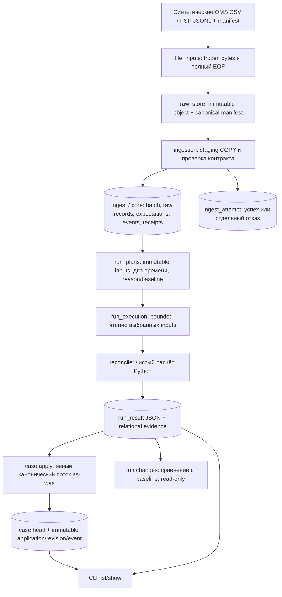

# Архитектура и границы согласованности

25.10.2026, S2/CG-204. Я описываю написанный код, который пока не запускал.
Фактическая схема — одна `commerceguard` в отдельной БД PostgreSQL 16;
`ingest_`, `core_`, `ops_` — префиксы таблиц, не отдельные SQL-схемы.
20 persistent tables, миграции 0001…0007. Я отделяю планы S3/S4 ниже.

## Как я провожу данные через написанные слои

Я сохраняю модульный сервис: kernel не импортирует Psycopg, HTTP, dbt или Prefect.
CLI разбирает параметры и вызывает адаптер, формулы находятся в reconcile.
Отдельные процессы/микросервисы не нужны только ради разделения файлов.
In-memory kernel ограничен 10000 OMS и 50000 receipts; объём/скорость не измерял.
Полная карта модулей и маршруты расширения — [PROJECT_MAP](PROJECT_MAP.md).

## Как я разделяю неизменяемое и текущее

| Группа | Что я сохраняю | Что разрешаю менять |
| --- | --- | --- |
| Raw | Байты входа и canonical manifest по SHA | Не перезаписываю |
| Core | Полные OMS snapshots, PSP business facts и каждую receipt | Не обновляю факты; повтор доставки — отдельная receipt |
| Run | Manifest/input IDs, result/evidence | Не обновляю опубликованные снимки |
| Attempt | Начало и терминальный исход | Только started → terminal, terminal immutable |
| Case | Head текущего наблюдения | Продвигаю явно в одном merchant stream |
| Case history | Application, revision, event | Только добавляю |

Балансы/findings хранятся в bounded result JSON; отдельной SQL-таблицы
ops_order_balance пока нет. Я не называю запланированную mart-модель физическим DDL.
Quarantine whole-package описываю в ingest_attempt; legacy ingest_quarantine
не выдаю за построчно заполненный журнал. Точные таблицы — [STORAGE](STORAGE.md).

## Где я провожу COMMIT

1. Raw: я устанавливаю immutable object и manifest в файловом хранилище.
   Это не транзакция БД; orphan возможен, автоматического удаления нет.
2. Ingest: я регистрирую started отдельно, затем одним COMMIT публикую batch,
   raw rows, core/receipts и успешную попытку. Не сохраняю валидный prefix плохого файла.
3. Run prepare: я сохраняю все input IDs и manifest одним COMMIT под merchant lock.
   Ни finding, ни Case это действие не создаёт.
4. Run execute: я регистрирую started, читаю immutable inputs в read-only snapshot,
   считаю вне idle transaction, затем публикую result/evidence/успех одним COMMIT.
5. Case apply: я сериализую поток магазина и сохраняю application, heads,
   revisions/events и stream одним COMMIT. Deferred FK связывает новый head с revision.

При потере связи во время COMMIT я не вывожу rollback из отсутствующего ответа.
Повторяю ту же identity и читаю ledger/result. Failure journal best-effort и не
перезаписывает терминальный успех. Case projection пока не имеет отдельного
failure-attempt журнала. Я описал это ограничение, а не заменил его run_attempt.

## Как я трактую время и повтор

Я сравниваю occurred/effective с as_of, observed с knowledge_at; опубликованные
пакеты ограничиваю technical marker. As-was требует равных границ. As-known-now
требует явного позднего knowledge и published baseline того же merchant/as_of.
Published_at до COMMIT не даёт точную историческую MVCC реконструкцию; exact replay
сохранённого набора обеспечивают manifest/input IDs. Engine SHA связывает run
с байтами реализации; старый fingerprint я не подменяю новым checkout.

Я не делаю current Case побочным эффектом завершения исторического расчёта.
Case apply принимает монотонный as-was stream, старый применённый run — noop,
регрессия/tie другого run — отказ. Historical correction остаётся report-only.
Absence — состояние наблюдения, workflow пока только open; человеческие решения S4.

## Что я планирую отдельно

В S3 я добавлю settlement, dbt SQL models, freshness и Prefect orchestration.
В S4 — FastAPI/Jinja2 рабочее место, локальные сессии/роли, назначение и аудит
человеческих действий. В S5 — bounded backfill, эксплуатационные метрики,
резервирование и поставку. Эти компоненты пока не написаны/не запущены.
Текущие pins относятся к Python/Psycopg, а не к ещё не введённым технологиям.

## Почему я выбрал эти границы

Я разделяю файловый контракт, immutable факты, вычисление и человеческий workflow,
потому что у них разные ключи, повтор и время жизни. Один PostgreSQL позволяет
атомарно фиксировать связанные записи, а raw оставляет доказательство исходного
входа. Сохранённый result объясняет прошлый вывод без обращения к latest данным.
Case хранит историю проблемы при изменении суммы. Цена — несколько явных команд,
больше metadata и необходимость отдельно определить promotion policy.
Я не скрываю эту цену словом exactly-once и не заявляю эксплуатационную готовность.
