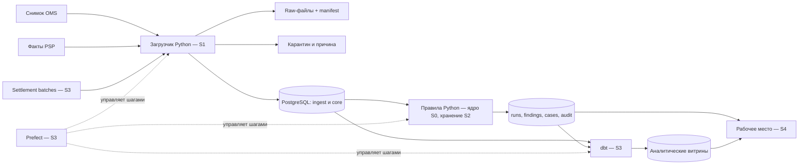

# Архитектура и границы согласованности

Диаграмма — целевое устройство. Написаны domain → reconcile → JSON CLI и
CG-101: SQL/runner миграций. Исполнение не выполнялось. Остальные слои будущие.
Физический storage CG-101 — одна схема commerceguard с префиксами ingest_/core_;
логические названия в таблице ниже сохраняют роль слоёв, а не точные SQL-имена.

## Один модульный сервис и одна БД

Предметный слой не импортирует FastAPI, Psycopg, Prefect или dbt. Адаптер CLI уже
вызывает его, затем добавятся application services и адаптеры файлов/БД/HTTP.
Разделение по ответственности, не отдельный сервис на каждое существительное.
Одна транзакционная БД упрощает согласованную публикацию результата и аудит.
По мере роста память kernel заменится чтением заказов порциями внутри фиксированного
снимка; значение правил останется тем же. Нельзя обещать, что текущий in-memory
kernel обработает целевой дневной объём: память не измерялась.

## План хранения

| Схема/объект | Зерно и ключ | Назначение |
| --- | --- | --- |
| ingest.batch | source + merchant + content_sha256 | Получен/разобран/готов/опубликован, version контракта и число строк |
| ingest.raw_record | batch_id + row_number | Ссылка на файл, исходная строка и результат разбора; без контактов |
| ingest.quarantine | raw_record_id + error_code | Ошибка структуры/контракта, не бизнес-расхождение |
| core.oms_snapshot | snapshot_id | Полнота, merchant, effective_at, observed_at, опубликованный manifest |
| core.order_expectation | snapshot_id + merchant_id + order_id | Ожидания двух денежных плеч |
| core.payment_event | merchant_id + source_event_id | Неизменяемый факт PSP, earliest observed_at и hash смысла |
| ops.reconciliation_run | run_id | Входные snapshot/batch IDs, cutoff, версия правил, причина и статус |
| ops.order_balance | run_id + merchant_id + order_id | Баланс на один запуск; нули отличаются от неизвестности |
| ops.finding_revision | run_id + case_key | Результат конкретного правила и ссылки на evidence |
| ops.case | case_key | Текущая операционная карточка; version для конкурентного изменения |
| ops.case_event | case_key + sequence | Append-only назначение, комментарий, решение, reopen, исчезновение finding |
| mart.* | Явно объявлено в каждой dbt-модели | Сводки очереди, свежести и денежных расхождений по валюте |

Точные DDL-имена восьми написанных таблиц — [STORAGE](STORAGE.md).
ops/mart и транзакции загрузки/расчёта пока проектные. Связь источника с выводом:
file hash → batch → raw_record → normalized fact → run → finding_revision → case.
Если архив raw удалён по политике, manifest и hash сохраняются; отсутствие файла
должно быть явно видно, а не скрыто неработающей ссылкой.

## Транзакционные границы

**T1, приём.** Файл пишется во временное имя внутри workspace, вычисляется hash,
завершённый файл атомарно переименовывается; manifest регистрируется в БД.
Файловая система и PostgreSQL не имеют общей транзакции: возможен бесхозный файл,
но не «опубликованный несуществующий пакет». Recovery сопоставляет hashes/manifest,
незарегистрированный файл можно повторно зарегистрировать. Это будущая реализация.

**T2, публикация партии.** COPY идёт в staging. В одной транзакции проверяются
контракт, повтор/конфликт ID, полнота ожидаемого снимка; вставляются новые факты
и manifest получает published. Нельзя показывать half-loaded OMS-снимок.
Исправленная версия снимка — новый snapshot_id; изменение исторической строки запрещено.

**T3, расчёт.** Run фиксирует IDs опубликованных входов и cutoff. Чтение согласованного
набора и запись вычисления должны использовать один зафиксированный набор;
предпочтение — REPEATABLE READ плюс явные immutable IDs. Проектное решение основано
на документированной модели PostgreSQL, где READ COMMITTED даёт снимок на команду,
а не один общий снимок на все команды транзакции. Это ещё не реализованная гарантия.
Для длительного расчёта снимок сначала материализуется логически через immutable IDs,
чтобы не держать read transaction часами и не мешать vacuum.

**T4, публикация результата.** Балансы, finding revisions и run published сохраняются
согласованно; обновление операционного кейса и соответствующий audit event выполняются
в одной транзакции. Несостоявшийся run не обновляет «последний успешный». Версии старых
расчётов остаются; канонический указатель меняется только после завершения целого run.

**T5, действие оператора.** UPDATE case WHERE version=expected_version и INSERT audit
в одной транзакции; отсутствие изменённой строки означает конфликт, а не успех.
Финансовое решение не переписывает finding_revision. Закрытый кейс может получить
reopen при новом расхождении, сохранив прежнюю причину закрытия.

## Повторы и сбои

Retry повторяет application command с идемпотентным ключом, не произвольный набор
SQL. Нельзя повторно отправлять комментарий с новым ID после сетевого timeout;
нужен request_id, сохранённый вместе с результатом команды. Late data создаёт новый
run, старый не пересчитывается на месте. Признак отсутствия данных отделяется от
нулевой выручки. Невалидная строка идёт в quarantine; бизнес-недоплата — в finding.

Перед удалением/перезаписью исторических raw потребуются отдельная retention-политика
и административное действие. В первой версии никаких автоматических DELETE history.
Операции оплаты отсутствуют, поэтому distributed transaction с PSP не проектируется.

## Аналитика и рабочее место

dbt агрегирует capture и refund отдельно до JOIN, чтобы несколько возвратов не
размножили оплаты. Публикуемая витрина ссылается на завершённый run_id, а не просто
«все последние строки». Prefect управляет последовательностью и повторами, но БД
остаётся источником истины: UI оркестратора не заменяет доменные статусы.
FastAPI отдаёт HTML через Jinja2; пагинация и фильтры на сервере, без отдельного SPA.

Официальная база решений и разделение фактов от предположений — [SOURCES](SOURCES.md),
компромиссы — [DECISIONS](../DECISIONS.md). Код, реализующий описанные T1–T5,
появится в соответствующих историях; присутствие диаграммы не означает его готовности.
