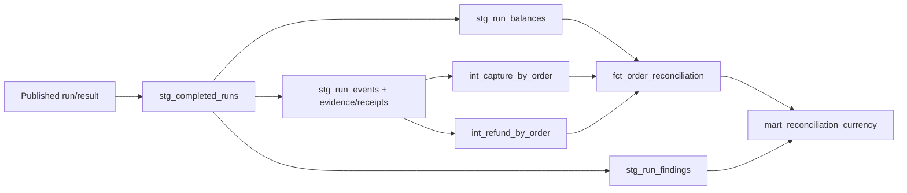

# CG-301: я превращаю сохранённую сверку в SQL-продукт

25.10.2026, `0.1.0.dev11`. Я построил 8 dbt views и выполнил 13 data tests на
PostgreSQL 16.15. Отдельно прошли 15 Python tests и полный integration runner.
Это первый срез с исполнением; все факты и оставшиеся пробелы — VALIDATION.

## Какую бизнес-задачу я решаю

Финансовому специалисту мало получить отдельный JSON каждой сверки. Ему нужна
таблица заказов и сводка одного отчёта по валюте: сколько заказов проверено,
какие заблокированы, сколько ожидается и сколько подтверждено. При этом поздняя
корректировка не должна молча заменить исходный отчёт. Я сохраняю run_id как
часть зерна и отдаю несколько отчётов отдельными наборами строк.

Я намеренно не называю эту витрину полным оборотом платёжного провайдера. Основная
таблица охватывает OMS balances. Платёж без заказа присутствует как finding и
в stg_run_events, но не добавляет выдуманный OMS заказ. При неверной валюте суммы
баланса остаются неизвестными. Так я отделяю контроль качества сопоставления
от задачи settlement, которую возьму следующей историей.

## Почему я выбрал этот инструмент

Я использую dbt Core 1.12.6 и dbt-postgres 1.11.0 в отдельной Python 3.12 среде.
Мне нужны обычные SQL SELECT, зависимости через ref и проверки данных рядом с
моделью. Для восьми представлений не нужен отдельный orchestrator или облачный
сервис. Текущая документация уже описывает dbt v2, но здесь я сознательно закрепил
v1 Core/adapter контракт и подтвердил его реальным build; не смешиваю две установки.

Все модели materialized=view в commerceguard_mart. Я не копирую деньги во второй
mutable snapshot и не ввожу расписание refresh преждевременно. Цена этого решения:
SQL выполняется при чтении, поэтому на больших объёмах понадобятся EXPLAIN,
индексы и, возможно, материализация. Пока я не измерял нагрузку и не утверждаю,
что этот вариант подходит любому размеру магазина. Core схема остаётся отдельно.

## Как я провожу данные через граф



| Узел | Зерно | Для чего я его выделил |
| --- | --- | --- |
| stg_completed_runs | run_id | Беру только сохранённый result известных версий; prepared не результат |
| stg_run_balances | run/merchant/order/currency | Раскрываю immutable JSON, привязываю к точной OMS raw row |
| stg_run_findings | run/case_key | Сохраняю orphan и currency mismatch независимо от наличия OMS balance |
| stg_run_events | run/merchant/source_event_id | Выбираю один видимый receipt на canonical event |
| int_capture_by_order | run/merchant/order/currency | Предварительно суммирую capture |
| int_refund_by_order | run/merchant/order/currency | Предварительно суммирую refund отдельно |
| fct_order_reconciliation | run/merchant/order/currency | Соединяю один balance с двумя агрегатами |
| mart_reconciliation_currency | run/merchant/currency | Показываю валютную сводку и число findings |

ref создаёт зависимость и имя relation, а не просто сокращает SQL. Я не вписываю
имя промежуточного представления вручную в соседнюю модель. source описывает
существующий core/ops, ref — модель, которую строю сам. Файлы находятся в
analytics/models/staging, intermediate и marts; проверки — в analytics/tests,
generic not_null/unique и описания — в analytics/models/schema.yml.

## Почему я агрегирую до соединения

Я беру заказ с тремя поступлениями: 10000, 200 и 300. Возвратов два: 70 и 30.
Правильные независимые суммы — capture=10500 и refund=100. Если соединить сырые
capture и refund только по заказу, получится шесть комбинаций. Сумма capture
станет 21000, а refund — 300. DISTINCT суммы не исправляет модель: две реальные
оплаты могут иметь одинаковый размер и всё равно должны обе учитываться.

Я сначала получаю одну строку capture и одну строку refund на выбранное зерно,
затем соединяю их с OMS balance. В integration fixture присутствует ещё один
receipt старого C01: новая доставка не новая оплата. stg_run_events выбирает один
видимый receipt по observed_at, batch_id и raw ordinal. Дедупликация сделана
внутри run, чтобы прошлый отчёт не зависел от более поздней доставки.

Это не выбор global latest из всех PSP. Я начинаю с ops_run_evidence сохранённого
run и применяю occurred_at<=as_of и receipt.observed_at<=knowledge_at. Поздний
пакет входит только в manifest нового отчёта. Точные batch/row/SHA остаются
в stg_run_events, а полный список доставок — в исходном evidence viewer.

## Какие поля я отдаю

В fct_order_reconciliation я сохраняю следующие группы полей. Это словарь
текущего публичного SQL-контракта, а не обещание будущего HTTP API.

| Поля | Смысл и ограничение |
| --- | --- |
| run_id, merchant_id, order_id, currency | Составной ключ строки; я не суммирую разные run или валюты |
| mode, as_of, knowledge_at | Вид отчёта, бизнес-граница и граница знания |
| ruleset_version, result_version, result_sha256 | Смысл правил и идентичность сохранённого результата |
| oms_snapshot_id, oms_batch_id, oms_raw_row_number | Точный источник ожиданий, не текущий latest OMS |
| state | matched/pending/discrepancy/blocked из сохранённого kernel |
| expected_capture_minor, expected_refund_minor | Два независимых обязательства OMS в minor units |
| actual_capture_minor, actual_refund_minor | Сохранённые известные суммы kernel; blocked даёт NULL |
| capture_delta_minor, refund_delta_minor | actual−expected из того же отчёта |
| capture_due_at, refund_due_at | Срок каждого плеча в новых results; старым срок не выдумываю |
| capture_state, refund_state, expectation_version | Per-leg контекст нового result v3 |
| has_per_leg_context | Признак наличия нового контракта; я не маскирую старый формат как v3 |
| receipt_capture_minor, receipt_refund_minor | Независимая SQL-агрегация видимых receipts для сравнения с kernel |
| capture_events, refund_events | Число уникальных видимых событий каждого плеча; blocked оставляет NULL |

В mart_reconciliation_currency ключ — run_id/merchant_id/currency. order_count,
blocked_orders, pending_orders и finding_count показывают размер и ограничения
среза. expected_capture_minor/expected_refund_minor включают все OMS balances.
known_actual_capture_minor/known_actual_refund_minor суммируют только известные
actual. Если все actual неизвестны, SUM возвращает NULL; я не заменяю его нулём.
При blocked expected и known_actual относятся к разной полноте, поэтому нельзя
трактовать их разницу как готовую сверку провайдера.

Я использую FULL JOIN агрегатов balances/findings: USD currency mismatch не теряется,
даже когда в OMS только RUB. У такой USD строки order_count=0, finding_count=1,
суммы OMS=NULL. Нулевое число строк и нулевая денежная сумма имеют разный смысл.
Все целые суммы остаются minor units; форматирование рублей выполняется выше.

## Как я разбираю версии и сбой

stg_completed_runs принимает известные result versions 1/2/3 и rulesets balance-v1/v2.
У старых results нет per-leg полей — я оставляю их NULL, а не пересчитываю историю
новым kernel. Текущий integration создаёт только result v3 с входами OMS v1/v2:
чтение исторических result v1/v2 пока отдельно не подтверждал. Это явный пробел.
Коррекции и as-was различаю по mode/run, автоматический latest/canonical выбор
оставляю потребителю. Складывать два отчёта одной даты как два дня нельзя.

dbt не является транзакцией публикации всего DAG. Если один view не построится,
часть моделей может уже существовать. Я устраняю причину и повторяю build; исходные
immutable reports от этого не меняются. Сейчас views не меняют core и не двигают
Case. Атомарную смену всего аналитического набора и ограниченные права потребителя
ещё предстоит определить при эксплуатационной поставке.

Первый integration выявил реальную ошибку до dbt: повторный raw persist вызывал
keyword-only artifact позиционно. Я исправил два вызова RawStore и добавил
regression repeat/resolve/corruption. Две начальные ошибки unit fixtures и имя
psp-late в runner тоже исправил; production контракт не ослаблял ради зелёного
вывода. Это наблюдённые ошибки разработки, а не придуманные аварийные испытания.

## Как я запускаю и исследую

Unit и одноразовый integration запускаю командами README. Runner создаёт собственный
кластер, четыре completed reports и ещё один prepared run; последний в mart не входит.
Он же выполняет build и сравнивает суммы 10500/100, USD/NULL и SHA старого result.
Сервер останавливается в finally, временные данные удаляются. Ничего постоянного
и сетевого для этой проверки не устанавливаю. PostgreSQL binaries должны быть доступны.

Для отдельной уже подготовленной БД commerceguard я задаю CG_PGHOST, CG_PGPORT,
CG_PGUSER и при необходимости DBT_ENV_SECRET_CG_PASSWORD через окружение. Значения
не записываю в profiles.yml. Затем из корня приложения:

```bash
.venv/bin/dbt build --project-dir analytics --profiles-dir analytics
```

В собственном SQL редакторе я начинаю с SELECT по fct_order_reconciliation с явным
run_id, затем смотрю mart_reconciliation_currency того же run. Для происхождения
оплаты иду в stg_run_events, для ожидания — по oms_snapshot_id/batch/raw row.
Между проверками и самостоятельными изменениями сохраняю Git diff. Локальные
target/logs содержат служебные пути и соединение; в публичное дерево их не включаю.

## Пять заданий, которые я могу выполнить

1. Я мысленно заменяю два pre-aggregates сырым JOIN. Для fixture 3×2 ожидаю шесть
   строк, 21000 capture и 300 refund. amount_parity должен заметить расхождение.
   Я объясняю, почему SUM(DISTINCT amount) неверен при равных реальных платежах.
2. Я добавляю discrepancy_orders в валютную витрину. Ожидаю COUNT(*) FILTER по
   state='discrepancy' из balances; findings сначала агрегирую отдельно, иначе
   один заказ с двумя findings увеличит количество заказов.
3. Я заменяю blocked NULL на 0 в order mart. Ожидаю нарушение amount_parity и
   integration проверки O1005. Возвращаю NULL; нуль означает подтверждённое
   отсутствие суммы только в допустимой области, а не неизвестную валюту.
4. Я создаю prepared run без execute. Ожидаю его отсутствие в stg_completed_runs
   и downstream marts. Появиться он должен после сохранения result, не после
   started attempt или успешного prepare.
5. Я добавляю ещё один refund event 25 в synthetic fanout fixture и меняю ожидаемый
   итог на 125. Capture должен остаться 10500; число refund events станет 3.
   Один repeat receipt старого refund не должен дать 150. Я повторяю unit/integration.

Эти ответы задают способ контроля моей правки; их не выдаю за уже выполненные
новые эксперименты. Базовый fixture и проверки выше фактически прошли.

На собеседовании я могу объяснить: что означает зерно; почему ref важнее имени
таблицы строкой; чем receipt отличается от event; почему SUM(NULL) не ноль;
почему несколько snapshots нельзя складывать; что доказывает SQL/Python parity
и чего она не доказывает о внешнем источнике. Следующий CG-302 добавит settlement,
а Prefect, freshness, UI, роли и эксплуатация пока остаются в backlog.

## CG-302: я добавил девятую витрину

26.10.2026. Я добавил mart_settlement_reconciliation с зерном report_id и двумя
новыми sources. Вывожу advice revision/currency/period/cutoff/tariff, reported/
expected суммы, completeness и raw/engine/result lineage. Latest не выбираю,
revisions не складываю. Для unknown ожидаемые суммы остаются NULL. Пять generic
и один singular settlement test расширили набор13→19; полный build9models/19tests
дал PASS28. Contract/формулы/ограничения — SETTLEMENT.

## CG-303: я строю витрины как последний шаг flow

Dbт v1 остаётся в analytics .venv. Pipeline вызывает его отдельным процессом по
тому же явному DSN и temporary profiles/target/logs, проверяет9models/19tests.
Marts failure даёт Failed всему flow, уже сохранённый report остаётся доступен.
Resume повторяет build, без общей atomic замены всех views. Подробности — ORCHESTRATION.
