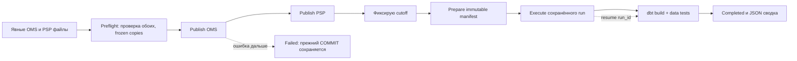

# CG-303: я управляю локальной цепочкой через Prefect

26.10.2026, `0.1.0.dev13`. Я объединил существующие сервисы в последовательный
flow: preflight → OMS → PSP → cutoff → prepare → execute → marts. Финансовые
формулы оставил в kernel, данные и результаты — в PostgreSQL. Prefect управляет
порядком исполнения и ограниченными повторами; самостоятельным финансовым
хранилищем он не становится. Это учебная разработка на синтетических примерах.

## Какую рабочую проблему я решаю

Ручной запуск отдельных команд легко остановить между шагами, забыть повторить
витрины или перепутать идентификатор отчёта. Я хочу одной командой получить
понятную сводку: что уже принято, какой run подготовлен, где возникла ошибка,
сколько было попыток и можно ли безопасно продолжить. Успешный ingest ещё не
означает успешную цепочку, а сохранённый report не исчезает после ошибки dbt.

Я выбрал обычные синхронные вызовы Prefect tasks: каждый следующий шаг начинается
после подтверждения предыдущего. Для двух входов одного merchant параллельность
не приносит полезного выигрыша и усложняет разбор частичного успеха. .submit(),
расписания, worker deployment, Cloud и постоянный сервер сейчас не нужны.
Я ограничиваю историю ручным локальным запуском; freshness и catalog идут отдельно.

## Почему у меня два Python окружения

Я закрепил Prefect3.8.8, FastAPI0.154.0 и Psycopg3.3.6 в отдельном
requirements-orchestration.in/lock. С hashes установил107 distributions в
.venv-orchestration. В analytics .venv сохранил dbt Core1.12.6/dbt-postgres1.11.0
и61distribution прежнего lock. Это явная цена оркестратора: зависимостей стало
больше. Полный список, версии, назначения и ссылки сохраняю в TECHNOLOGIES.

Я не заставляю resolver искать случайный общий набор для двух крупных инструментов.
Prefect вызывает analytics Python отдельным процессом, а тот запускает dbtRunner.
В документации dbt параллельные вызовы v1 в одном процессе не считаются безопасными;
отдельный процесс также изолирует глобальные настройки и ошибки библиотеки.
HTTP зависимости Prefect обслуживают только его внутренний backend. Веб-рабочее
место CommerceGuard, бизнес-HTTP API и роли S4 этим не реализованы.

При первом запуске я обнаружил реальную несовместимость: FastAPI0.162.0 отклоняла
Body(..., min_items=1), который использует Prefect. Начиная с0.155 FastAPI убрала
устаревшие **extra параметры. Я сверил release notes, закрепил0.154.0 и проверил
реальное выполнение. Просто успешной установки зависимостей для этого недостаточно.

## Где проходит граница процесса

Команда pipeline запускает дочерний Python из текущего orchestration окружения.
До импорта Prefect я создаю приватный временный каталог, задаю PREFECT_HOME и
profiles path, очищаю наследуемые PREFECT_* переменные. Поэтому прежний Cloud URL,
ключ или профиль не подхватывается случайно. Cwd тоже временный: проектные .env и
конфигурация Prefect из корня checkout не участвуют в поиске настроек.

Я включаю ephemeral backend на127.0.0.1, выключаю серверную аналитику, orchestration
telemetry и публикацию логов в API. Перед flow проверяю настройки: внешний API URL
и key отсутствуют, home находится внутри job. В finally вызываю stop() собственного
SubprocessASGIServer; он завершает и ожидает свой процесс. Это временный локальный
HTTP listener, который нужен Prefect, а не установленная служба. SQLite состояния,
конфигурация, frozen inputs и логи удаляются вместе с job после ответа команды.

Я не сохраняю task result в Prefect и отключаю его cache policy. Решение «уже
выполнено» принимают существующие DB identities, не локальный cache оркестратора.
Защиту от любого исходящего сетевого соединения настройками не доказываю:
отдельного сетевого аудита не выполнял. Cloud для этого маршрута не требуется.

## Как я провожу данные через шаги



Preflight сначала проверяет analytics версии и контракт подключения, затем полностью
разбирает оба файла до EOF. Я сверяю source и merchant, сохраняю canonical manifest
и копию frozen bytes. Исходный файл после этого может измениться, но автоматический
retry читает private snapshot. У прежнего input контракта остаются пределы100MB,
10^6records и1MB на запись; pipeline их не снимает. Snapshot — не общий atomic
filesystem transaction и не доказательство одновременности создания двух выгрузок.

Публикация OMS и PSP использует существующий raw-first/COPY/COMMIT. Общей
транзакции на два источника я не создаю. Если OMS подтверждён, а PSP конфликтует,
OMS остаётся опубликованным. Сводка показывает его batch_id и выполненные шаги;
это не ложный rollback и не overall success. Исправление PSP не требует удаления
OMS или reset базы. Raw orphan и неопределённый COMMIT сохраняют прежние правила.

После prepare я проверяю, что manifest действительно включает batch IDs, только
что переданные flow. Если selector выбрал другой OMS или старый PSP не попал в
cutoff, останавливаюсь с PIPELINE_INPUT_NOT_SELECTED. Не выдаю сверку случайно
выбранных источников за обработку загруженного набора. Сам prepared manifest
при таком отказе может остаться в БД без result: это разрешённое состояние.

## Почему now я определяю после ingest

Деловой период документа и момент, когда я публикую файл, различаются. Если взять
cutoff перед сегодняшним ingest, newly published batch ещё не видим. Поэтому
--as-of now означает часы PostgreSQL после обоих подтверждённых publish.
Я получаю значение один раз отдельным шагом и дальше использую его неизменно.
В ответе возвращаю точный RFC3339 с микросекундами.

Я также принимаю явный --as-of RFC3339, нормализую его в UTC. Будущее отвергает
существующий prepare; нужные пакеты должны быть видимы к выбранной границе.
Повтор с now намеренно создаёт новую временную точку. Для точного повторения я
передаю прежний as_of либо использую pipeline resume --run-id. Я не подменяю now
скрытым идентификатором последнего успешного запуска.

## Как я ограничиваю повторы

У task разрешены максимум две повторные попытки после первой: всего три запуска,
задержки1и3секунды. retry_condition_fn разрешает повтор только для PipelineError
с retryable=true. В production adapter такими причинами сейчас являются
MERCHANT_BUSY/SCHEMA_BUSY при ingest и RUN_BUSY при execute. Эти операции уже
имеют DB identity; frozen inputs не меняются между попытками.

PSP_CONFLICT, повреждённый JSON/hash, отсутствие источника, engine mismatch,
ошибка миграции и dbt test failure автоматически не повторяются. В частности,
DATABASE_UNCONFIRMED я не превращаю в «наверняка временно»: обрыв COMMIT требует
проверки/повтора точной identity. Prepare и marts не получают слепого retry.
У самого flow retries=0, поэтому сбой последнего шага не перезапускает всю цепочку.
Проверка transient — консервативный allowlist, не универсальная классификация
всех возможных сетевых и серверных отказов.

## Как я подключаю dbt к той же базе

Я передаю только имя внешней переменной --dsn-env, значение DSN не кладу в Prefect
parameters или JSON отчёт. Analytics adapter разбирает тот же DSN через Psycopg,
требует явные host/user/dbname=commerceguard, port по умолчанию5432. Пароль передаёт
через DBT_ENV_SECRET_CG_PIPELINE_PASSWORD. Временный profiles.yml содержит env_var,
а не пароль. Прежние CG_PGHOST/CG_PGUSER из отдельного ручного dbt запуска здесь
не определяют другую базу.

Я поддерживаю одиночный host/Unix socket, port, user/password и sslmode/cert/key/
rootcert. Opaque service, multi-host, hostaddr и произвольные options пока
отклоняю до ingest: молча потерять параметры соединения опаснее явного отказа.
Probe проверяет форму подключения/версии, а не доступность БД и права на все views.
Сами доступность, schema и permissions проверяются при реальной операции.

Я выполняю все9models и19data tests текущего проекта. Успех означает success
вызова и pass/success каждого узла run_results, не только exitcode0. Target/logs
создаю в приватном временном каталоге, исходный analytics проект читаю из checkout.
Частично заменённые views при сбое dbt не откатываю общей транзакцией: resume
повторно строит их. Это не atomic переключение целого набора витрин для читателей.

## Где я меняю реализацию

| Файл | Что я держу в нём и почему |
| --- | --- |
| pipeline.py | Я изолирую процесс, фиксирую входы и адаптирую существующие сервисы к безопасным ошибкам |
| pipeline_flow.py | Я задаю tasks, последовательность, retry policy и прогресс; денег здесь не считаю |
| pipeline_worker.py | Я проверяю local settings, запускаю один flow и останавливаю его backend |
| pipeline_dbt.py | Я вызываю dbtRunner в другом окружении и проверяю артефакт результата |
| __main__.py | Я описываю аргументы run/resume и JSON/exitcode |
| tests/test_pipeline.py | Я проверяю snapshots, allowlist retry, connection contract и отсутствие private значений в ошибке |
| scripts/check_pipeline.py | Я прохожу реальные flow на собственной временной PostgreSQL |
| scripts/pipeline_faults.py | Я инъецирую временный отказ и сбой marts только внутри проверки, без production CLI флагов |

Schema остаётся9/24tables+9views, опубликованные миграции не меняю. Отдельный
persistent pipeline journal пока не добавил. У ingestion/run остаются свои DB
attempts; история временного Prefect backend после команды не сохраняется.
Сводку stdout можно сохранить локально для продолжения. Наличие файла сводки
не заменяет чтение authoritative DB result.

## Как я запускаю и продолжаю работу

Я готовлю два окружения по README и собственную отдельную БД по STORAGE, применяю
миграции явной командой db migrate. Pipeline автоматически не мигрирует схему.
Из корня checkout запускаю:

```bash
.venv/bin/python -m commerceguard input generate --output workspace/input-flow
.venv-orchestration/bin/python -m commerceguard pipeline run \
  --merchant M01 --as-of now \
  --oms-manifest workspace/input-flow/oms.manifest.json --oms-data workspace/input-flow/oms.csv \
  --psp-manifest workspace/input-flow/psp.manifest.json --psp-data workspace/input-flow/psp.jsonl \
  --raw-root workspace/raw --analytics-python .venv/bin/python
.venv-orchestration/bin/python -m commerceguard pipeline resume \
  --run-id UUID_ИЗ_ОТВЕТА --analytics-python .venv/bin/python
```

UUID placeholder заменяю своим run_id. --merchant сверяет оба входа; четыре
file аргумента задают явные пути, manifest сам не выбирает файл. --raw-root указывает
managed raw store. --analytics-python выбирает Python с analytics lock; команду
pipeline запускаю Python из orchestration lock. --dsn-env по умолчанию
COMMERCEGUARD_DATABASE_URL. --as-of now или RFC3339 определяет границу знания.
Resume принимает существующий run_id и пропускает ingest/cutoff/prepare; execute
читает сохранённые входы, dbt строится повторно. Case apply и settlement run в
эту цепочку автоматически не включаю.

Я получаю status, prefect_state, stage, completed_stages, attempts, batch/run IDs,
result SHA, counts и backend_stopped. При failed команда возвращает exitcode2.
Сводка не содержит исходных строк, абсолютных input путей, значение DSN или пароль.
Главный процесс ограничен900секундами, analytics subprocess300секундами; это
предел ожидания, не обещание времени обработки. На POSIX прерывание завершает
группу дочерних процессов, затем очищает job. SIGKILL, power loss и Windows
полностью не проверял; при аварии живой ephemeral state не считаю authoritative.

## Как я изучаю этот слой: пять упражнений

1. Я запускаю полный flow, затем повторяю с точным as_of из ответа. Ожидаю те же
   batch IDs/run_id/result SHA, duplicate_batch и duplicate_result. Замена на now
   может дать новый run, поскольку изменилось время.
2. Я меняю исходный PSP после freeze в unit сценарии. Ожидаю неизменные bytes
   snapshot; объясняю, почему повтор не читает отредактированный оригинал.
3. Я пытаюсь принять semantic конфликт уже известного PSP event. Ожидаю одну
   попытку PSP, Failed, отсутствие execute/marts; ранее принятый OMS сохраняется.
4. Я запускаю fault runner: один MERCHANT_BUSY приводит ко второй попытке,
   постоянный busy исчерпывает три. Ошибка marts не ретраится автоматически;
   сохранённый report читается, resume завершает витрины.
5. Я задаю другое имя БД либо service-only DSN. Ожидаю preflight failure до приёма,
   затем исправляю явные host/user/dbname. Я объясняю, почему нельзя строить dbt
   по независимому набору переменных и случайно получить две разные базы.

Для собеседования я объясняю границу task/DB transaction, partial success,
идемпотентность без Prefect cache, fixed cutoff против now, allowlist retries,
разницу Failed flow и сохранённого business result, а также ограничения
эпизодического backend и отсутствие долговечного pipeline journal.


## Мои фактические подтверждения этого среза

Я выполнил38unit tests в двух окружениях и оба integration runner на Linux/
PostgreSQL16.15. Новый pipeline прошёл normal/replay/partial failure/preflight
reject, управляемые retry2/3attempts, failure marts и CLI resume. Старый runner
повторно подтвердил settlement11reports и dbtPASS28. Полная матрица и реальные
ошибки — VALIDATION. CI/Windows/power loss/concurrent writers пока не проверял.

## CG-304: я наблюдаю источники отдельно от состояния flow

Я добавил source health как отдельный read-only CLI и описал его в FRESHNESS.
Prefect Completed не означает свежий источник; его часы не определяют historical
baseline. Analytics теперь62distribution с tzdata2026.5, orchestration107версий
сохранились. 53unit в обеих средах и оба runner прошли, logic flow не менял.
