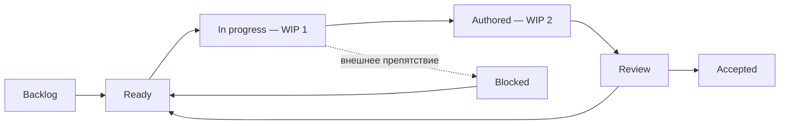

# Рабочий процесс: Scrum и Kanban для одного проекта

## Что адаптировано

Я использую Product Goal, упорядоченный Product Backlog, цель каждого спринта,
планирование, краткий журнал, обзор результата и ретроспективу. Kanban добавляет
явные состояния, pull-порядок и WIP. Руководство Scrum описывает командную работу;
я применяю эти практики в личном учебном проекте. Отдельную Scrum-команду
и проведённые командные встречи не заявляю.
Официальные источники: [Scrum Guide](https://scrumguides.org/scrum-guide.html)
и [Kanban Guide for Scrum Teams](https://www.scrum.org/resources/kanban-guide-scrum-teams).

Я веду backlog, определяю приоритеты, проектирую и пишу код. Отдельного Scrum Master
и реального заказчика в учебном проекте нет. Обзор своего результата отделяю
от обратной связи внешнего читателя и не называю отзывом клиента.

## Каденция

После подготовительного Sprint 0 план — недельные спринты, по одному небольшому
срезу за рабочий заход. Конкретный старт/объём S1 назначается при его начале;
даты будущих поставок не обещаются. Перед спринтом — цель, выбранные истории,
зависимости и риски. В конце — review материалов, что реализовано, что не исполнялось,
что осталось и одно улучшение процесса. Отдельная ретроспектива не должна подменять review.

Daily — запись по фактическому заходу в WORKLOG: цель, сделанное, статус, препятствие,
следующий шаг. Никаких фиктивных ежедневных отчётов в дни без работы. Изменение
плана записывается с причиной; историю не переписываем ради красивого burn-down.

## Состояния доски

Backlog — сформулированная идея, ещё не обязательство. Ready — понятны контракт,
критерии и зависимости. In progress — одна активная история. Authored — материалы
написаны, но выполнение/приёмка не подтверждены. Review — доступен конкретный
артефакт для обсуждения. Accepted — зафиксирована фактическая приёмка, включая
известные ограничения; это не автоматически эксплуатационная готовность.

Blocked требует причины и условия снятия, не просто «сложно». Просмотр файлов
для планирования не переводит историю в Accepted. Появление `.py` не равно Done.
WIP Authored ограничен двумя историями; достигнув лимита, следующий заход сначала
упаковывает текущие материалы для review, а не начинает третью независимую функцию.
Если внешнего review пока нет, продолжаю зависимый срез с явной записью
предположений; это не заменяет проверку или приёмку.

## Definition of Ready

Есть ID, пользователь/ценность, вход/выход, конкретные примеры и критерии,
зависимости, допустимый способ реализации и ограничение текущего захода. История
не должна одновременно включать новую БД, UI и backfill без деления на срезы.
Размер S/M/L — субъективная относительная оценка сложности, не часы и не velocity.

## Готовность написанного среза

Исходники и контракт согласованно описаны; есть понятная точка входа, существенные
ошибки предусмотрены кодом, причины решений записаны, нет пользовательских данных,
документация явно отличает реализованное от планируемого. Есть Git-коммит только
проекта и обновлённые board/worklog. Если исполнение запрещено, статус остаётся
Authored/Review с отметкой unverified; не выдаю его за доказанно usable Increment.

Для готовности к реальной эксплуатации нужна отдельная инженерная приёмка
корректности, отказов, доступа и восстановления. Сейчас она не выполняется
в выбранном мной режиме. Фиксирую это ограничение качества отдельно
от факта написания исходников.

## Политика исполнения

Не запускать приложение, тесты, smoke, SQL, сборку, линтер, статический анализатор,
контейнеры или CI. Не маскировать запуск как «демонстрацию» или «быстрый check».
Писать код последовательно по зафиксированному контракту; числовые примеры помечать
как ручной расчёт. Чтение первичной документации и административные операции Git
разрешены и не являются запуском проекта. Указание действует на следующие этапы
этого проекта до моего отдельного явного решения о смене режима.

## Git и публичная работа

Собственный корень Git apps/commerceguard, ветки codex/<sprint>-<slice>. Перед
индексацией корень должен совпасть с каталогом приложения; родительский Git не трогать.
Публикация по PUBLIC_FILES.txt. В main допустима стартовая страница; срез оформляется
Draft PR с указанием отсутствия исполнения. Принятие PR и принятие бизнес-функции —
разные события, их нельзя автоматически связывать. Нет фиктивных зелёных проверок
и stable release для непроверенной системы. В дальнейшем маленький PR на историю,
без смешивания домашних файлов, секретов и чужих изменений.

## Метрики процесса

Сначала считаем только факты: активные истории, написанные срезы, открытые решения.
Cycle time и throughput появятся после реальных переходов с датами. Нет начальной
velocity, процентов «готовности системы» и burn-down из придуманных часов.
Операционные метрики продукта из PRD не равны метрикам процесса разработки.
